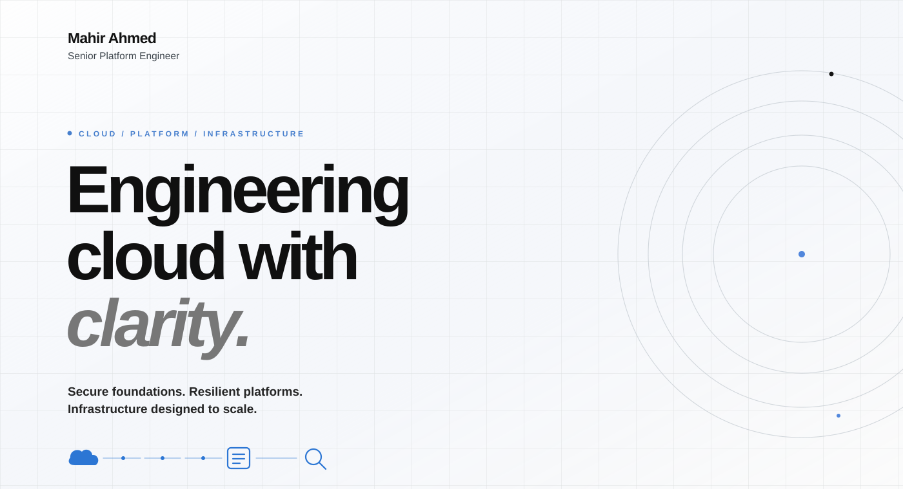
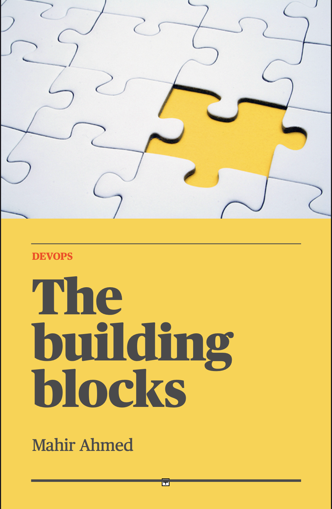

 

[**Website**](https://mahirahmed691.tech) &nbsp; / &nbsp; [**LinkedIn**](https://www.linkedin.com/in/mahir-ahmed-84a346149/) &nbsp; / &nbsp; [**Writing**](https://dev.to/mahirahmed691) &nbsp; / &nbsp; [**Contact**](mailto:mahirahmed691@gmail.com)

 

01 / PROFILE

## Engineering for the long term.

I'm **Mahir Ahmed**, a **Senior Platform Engineer** focused on cloud architecture, platform engineering and infrastructure automation.

I work on the foundations that let engineering teams deliver with confidence: cloud landing zones, identity and access, networking, reusable infrastructure, delivery pipelines and disaster recovery. My experience includes leading the design and planning of large-scale **AWS-to-Google Cloud** migrations.

My approach is straightforward: **build secure foundations, remove unnecessary complexity and make reliability an architectural decision.**

 

02 / CAPABILITIES

## What I work on.

| Focus | Practice |
| :--- | :--- |
| **Cloud platforms** | AWS · Google Cloud Platform |
| **Cloud architecture** | Landing zones · IAM · Networking · Guardrails |
| **Platform engineering** | Shared services · Reusable patterns · Developer enablement |
| **Cloud migration** | Migration strategy · Workload transitions · DR planning |
| **Infrastructure as code** | Terraform · Infrastructure automation |
| **Containers & delivery** | Kubernetes · Docker · CI/CD |
| **Operations & reliability** | Linux · Resilience · Operational readiness |

`AWS` &nbsp; `GCP` &nbsp; `Terraform` &nbsp; `Kubernetes` &nbsp; `Docker` &nbsp; `Linux` &nbsp; `GitHub Actions` &nbsp; `Bash` &nbsp; `Python`

 

03 / WRITING

## Notes from the field.

I write about the tools, decisions and engineering principles behind modern infrastructure.

- **Cloud & migration** — [Cloud Migration Best Practices: Ensuring a Smooth Transition](https://dev.to/mahirahmed691/cloud-migration-best-practices-ensuring-a-smooth-transition-1d2p)
- **Platform tooling** — [Exploring Essential DevOps Tools: A Comprehensive Guide](https://mahirahmed691.tech/exploring-essential-devops-tools-a-comprehensive-guide)
- **Kubernetes** — [A Beginner's Guide to Kubernetes: Understanding the Basics](https://mahirahmed691.tech/a-beginners-guide-to-kubernetes-understanding-the-basics)
- **Financial services** — [DevOps in FinTech](https://dev.to/mahirahmed691/devops-in-fintech-5eaf)
- **Linux** — [Linux Commands](https://dev.to/mahirahmed691/linux-cmds-135c)
- **Software craft** — [Best Code Practices and Writing Clean Code](https://dev.to/mahirahmed691/best-code-practices-and-writing-and-clean-code-1a1e)

 

04 / PUBLICATIONS

## Longer-form thinking.

<table>
  <tr>
    <td width="50%" align="center" valign="top">
      
      
<strong>Cloud Agnostic</strong>

      <a href="assets/Cloud%20Agnostic.pdf">Read the publication</a>
    </td>
    <td width="50%" align="center" valign="top">
      
      
<strong>The Building Blocks of DevOps</strong>

      <a href="assets/The%20Building%20blocks-%20Devops.pdf">Read the publication</a>
    </td>
  </tr>
</table>

 

05 / OPEN SOURCE

## Selected repositories.

**[Holidai](https://github.com/mahirahmed691/holidai)**  
View repository ↗

**[Puppet](https://github.com/mahirahmed691/puppet)**  
View repository ↗

[Explore all repositories](https://github.com/mahirahmed691?tab=repositories)

 

06 / GITHUB

## Activity and contributions.

For a live view of my GitHub activity, explore my [contribution history](https://github.com/mahirahmed691?tab=overview), [repositories](https://github.com/mahirahmed691?tab=repositories) and [profile overview](https://github.com/mahirahmed691).

These links use GitHub directly rather than third-party statistics images.

 

---

### Good infrastructure is intentional.

Open to conversations about cloud architecture, platform engineering and building dependable systems.

[Website](https://mahirahmed691.tech) &nbsp; · &nbsp; [LinkedIn](https://www.linkedin.com/in/mahir-ahmed-84a346149/) &nbsp; · &nbsp; [Email](mailto:mahirahmed691@gmail.com)

MAHIR AHMED / PLATFORM ENGINEERING

